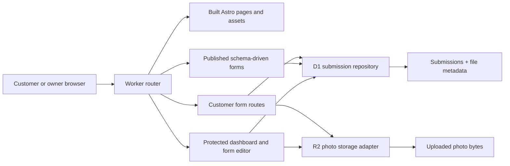

# Site Architecture

This project uses Astro to build a static website. "Static" means Astro turns
the source files into normal HTML, CSS, JavaScript, and image files before the
site is deployed. A server does not need to assemble each page when a visitor
opens it.

## Build and Hosting Flow

```text
Astro source files
  src/ and public/
        |
        | npm run build:site
        v
Static website
  dist/
        |
        | npm run build:worker
        | bundles src/server/worker-entry.js
        v
Hosted Worker
  index.mjs and dist/server/index.js
```

The hosted Sites project deploys the generated Worker from
`dist/server/index.js`. The same generated code is also kept in the root
`index.mjs` file for source history and compatibility. Astro creates the static
site first. `scripts/generate-static-worker.cjs` then packages the finished
assets and bundles the modular server entry point into both Worker files. The
generator contains packaging code only; form handling, database storage, photo
storage, dashboard behavior, and routing live in focused files under
`src/server/`.

## Important Folders

```text
.
+-- astro.config.mjs
+-- package.json
+-- index.mjs                 generated Worker copy kept in source history
+-- src/
|   +-- pages/                one Astro page for each public route
|   +-- components/           reusable page pieces such as navigation
|   +-- layouts/              shared page structure
|   +-- server/
|       +-- worker-entry.js   central request router
|       +-- routes/           one handler per customer form
|       +-- forms/            form registry and shared form-schema rules
|       +-- storage/          D1 submissions, form drafts, and versions
|       +-- adapters/         R2 photo-storage integration
|       +-- dashboard/        protected dashboard reading and deletion
|       +-- common/           small shared HTTP helpers
|       +-- static-files.js   serves the built Astro assets
+-- db/
|   +-- schema.ts             relational D1 schema
+-- drizzle/                  versioned SQL migrations
+-- public/
|   +-- assets/               files copied without changing their URLs
+-- dist/                     temporary build and deployment package
+-- scripts/
|   +-- generate-static-worker.cjs
+-- docs/
    +-- architecture.md
    +-- requirements.md
```

The three main folders have different jobs:

- `src/` contains the Astro pages, components, layouts, styles, and JavaScript
  that developers edit.
- `public/` contains files that should keep a fixed public URL. For example,
  `public/assets/images/photo.jpg` becomes `/assets/images/photo.jpg`.
- `dist/` is created by Astro. Do not edit it by hand because the next build
  replaces it. It is ignored by Git.

## Current Server Structure



The Worker router is now a small traffic controller. It decides which focused
handler receives a request; the handler then uses an adapter for the outside
service it needs. This keeps a future form from requiring edits throughout one
large generated script.

## Public Routes

Astro builds these routes as directory-style HTML files. For example,
`/about/` is built as `dist/about/index.html`.

```text
/
/about/
/contact/
/sukka-builder/
/sukkah-rentals/
/custom-sukkahs/
/pergolas/
/tree-trimming/
/eruv-work/
/request/<published-form-slug>/
```

The configuration uses static output, directory-format pages, and trailing
slashes. The Worker also keeps the previous convenience behavior where a URL
without a trailing slash, such as `/about`, can load the `/about/` page.

The former package overview, buy, and sample URLs are generated as compatibility
redirect pages that send visitors to `/sukka-builder/`.

`/sukka-builder/`, `/sukkah-rentals/`, and `/request/<published-form-slug>/`
all use the same `ManagedRequestForm` renderer. The browser requests the active
published definition from `GET /api/forms/<slug>`, and the Worker validates the
same definition before saving a submission. Builds and Rentals are built-in
managed schemas with stable slugs (`builds` and `rentals`), so the owner can
edit the live forms from the dashboard without changing page code. Their
submissions still use the existing `build` and `rental` dashboard categories.

Every step stores a selectable section icon (`contact`, `location`, `timing`,
`sukkah`, `site`, `final`, `phone`, `home`, `ruler`, `tools`, `message`, or
`photo`). The shared renderer draws those icons with the same outlined style
used by the original live forms. The dashboard uses a visual picker so the
owner sees the actual icon artwork while choosing one for built-in or newly
created forms.

The schema also stores optional placeholder text for short text, email, phone,
and paragraph controls. The dashboard edits this property and the shared
renderer applies it to the matching native control while keeping the question
label separate for accessibility.

All managed forms use the shared guided progress, card, field, choice, review,
validation, and success presentation. Builds and Rentals keep their stable
field names for existing backend and dashboard reporting. Native date inputs
are explicitly allowed to shrink inside their grid so iOS Safari cannot push
the form beyond the card edge.

The initial managed Custom Sukkah form demonstrates text, email, phone,
dropdown, radio-card, checkbox-card, paragraph, photo, and conditional
follow-up fields. The closing action on `/custom-sukkahs/` links to
`/request/custom-sukkah/`.

## Builds

The `/sukka-builder/` route keeps its existing URL but is labeled `Builds` in
the interface. It is intended for sukkahs the customer already owns and no
longer has a purchase-path selector. The page contains the custom form
directly. Visitors can select up to three optional area photos, with a 10 MB
limit for each photo.

Builds and Rentals import `src/styles/guided-request-form.css` for the shared
progress, card, fields, choice controls, navigation, review, validation, and
success presentation. Builds adds only the controls unique to its request,
including the sukkah-type and schach choices, the photo picker, and the
Bring-to-storage date. The Builds form is a client-side six-step flow:
Contact, Location, Timing, Requested work, Your sukkah, and Review and send.
Step navigation changes which existing form section is visible without
replacing controls or submitting, so values and selected files remain in place
until the final request.

The form uses this flow:

```text
Browser form
    |
    | multipart POST /api/sukkah-submissions
    v
Sites Worker
    |-- validates required fields and photo limits
    |-- stores photo files in the SUBMISSION_PHOTOS R2 binding
    `-- saves answers and file metadata in the DB D1 binding
```

Photo bytes stay in R2 instead of occupying database rows. D1 stores each
photo's key, original filename, type, size, and owning submission. Homepage
testimonials use the same repository and enter it with `Pending review` status.
An allowlisted owner can approve a testimonial in the protected dashboard.
Approval records the owner's email and approval time, after which the public
testimonials endpoint returns only the reviewer's public name, organization,
and testimonial text. Disapproval permanently deletes the pending record.

The form registry in `src/server/forms/registry.js` is the central list of
submission types, labels, endpoints, and dashboard source keys. The router and
dashboard consume that list, so a future form begins with one registered
definition and one focused validation handler rather than edits throughout a
large Worker script.

The `DB` D1 binding and `SUBMISSION_PHOTOS` R2 binding are declared in
`.openai/hosting.json`. They are hosting-managed resources rather than secrets.
The only dashboard environment value is the private owner allowlist.

## Shared Page Structure

Navigation and other repeated markup belong in reusable Astro components and
layouts. Changing a shared component updates every page that uses it during
the next build. This replaces the old system where the same navbar HTML had to
be copied into every page.

`src/components/Header.astro` owns the shared Sukkahs menu, direct Tree
Trimming and Eruv Work links, active-page states, and responsive menu behavior.
The desktop Sukkahs menu opens as a flat rail attached to the header. At tablet
and phone sizes, its links move into a full-height panel. The page body becomes
temporarily inert while that panel is open so keyboard focus stays inside the
navigation.

`src/components/Footer.astro` owns the repeated footer content and includes a
small Admin link to the protected `/admin/` dashboard. The link is intentionally
available on every shared-layout page while the dashboard still enforces owner
authentication.

`src/components/VisualOptionCard.astro` owns the repeated photo, heading, and
description surface used by the Custom Sukkahs Siding and Schach grids. Both
sections pass content into the same component so their image ratio, borders,
radius, and spacing stay synchronized across breakpoints.

## Worker Generation

`scripts/generate-static-worker.cjs` reads the completed static files in
`dist/`, encodes them with their routes and content types, and bundles
`src/server/worker-entry.js` with its imported server modules. It does not own
application behavior and it does not scan old root HTML files.

The Worker handles the live builder endpoint:

```text
POST /api/sukkah-submissions
POST /api/rental-submissions
POST /api/testimonial-submissions
GET  /api/sukkah-submission-photos/<unlisted-photo-key>
GET  /api/testimonials
GET  /api/forms/<published-form-slug>
POST /api/form-submissions/<published-form-slug>
GET  /api/admin/submissions
PATCH /api/admin/submissions
DELETE /api/admin/submissions
GET  /api/admin/forms[/<form-id>]
POST /api/admin/forms
PUT  /api/admin/forms/<form-id>
POST /api/admin/forms/<form-id>/publish
GET  /api/admin/forms/<form-id>/versions
POST /api/admin/forms/<form-id>/restore
```

The POST endpoints accept and validate their form data, store selected photos
in R2, and save one normalized submission plus its form-specific JSON answers
in D1. If the database write fails, newly uploaded photos from that request are
removed so partial submissions are not left behind.

`GET /api/testimonials` is public but returns only approved publication fields;
private verification contact details never leave the protected dashboard.
`PATCH /api/admin/submissions` is the authenticated approval action, while
`DELETE /api/admin/submissions` handles both ordinary deletion and testimonial
disapproval.

The Worker also preserves the existing placeholder endpoint:

```text
POST /api/sukkah-quote
```

This endpoint returns a sample JSON response. It does not calculate, store, or
send a quote. Astro remains a static page builder; the generated Worker owns the
small amount of server-side submission logic.

## Owner dashboard

The owner dashboard is a protected website route at `/admin/`. Its browser code
never talks to the database directly. It reads normalized data from the private
`GET /api/admin/submissions` Worker endpoint and sends confirmed deletion
requests to `DELETE /api/admin/submissions`.

The same protected page contains the form builder. It can create a new form,
edit or remove questions, reorder steps and questions, duplicate fields, edit
choice options, and configure a simple conditional follow-up. A checkbox-card
condition uses `includes`, while single-value controls use `equals`. Drafts are
saved separately from published versions, so editing does not change the live
form. Publishing creates an immutable numbered version; restoring an older
version copies it back into the draft for review rather than silently changing
the public form.

The dashboard separates these tools into Form builder and Submissions tabs, so
the editing workspace does not compete visually with the submission rows. The
builder preview uses the same field types and section icons as a live form. Its
controls are interactive for testing conditional questions, and scrolling the
editor or preview highlights and follows the matching section. The form chooser
is a compact snap-scrolling card rail on small screens with keyboard-friendly
previous and next buttons; on larger screens it remains a simple vertical list.

D1 stores the current draft in `forms` and immutable published snapshots in
`form_versions`. Dynamic submissions record both the published version ID and
a label-and-value snapshot for every visible answer. Consequently, renaming or
removing a question in a later version does not make earlier submissions
unreadable.

Sites supplies the signed-in user's email in a trusted request header. The
Worker compares that email with `DASHBOARD_ADMIN_EMAILS` before returning the
page or any data. A missing allowlist fails closed. Signed-out visitors are sent
to the Sites sign-in route, and signed-in accounts that are not on the allowlist
receive a forbidden response.

After authorization, the Worker queries D1 through prepared SQL statements.
Results are cursor-paginated, searchable, newest first, and always returned
with private, no-store headers. Common searchable values use normal database
columns, while each form's unique answers live in a JSON field.

The dashboard shows each submission as a responsive row with View and Delete
actions. Delete is permanent and therefore uses a separate confirmation dialog.
The authenticated Worker validates the entry type and ID, removes the D1 record
and its related file metadata, then removes the corresponding R2 photo objects.
The foreign-key relationship prevents orphaned database file records.

The Submissions tab also contains an optional direct Google Sheets reporting
export. The owner pastes a Sheet URL after the deployment has been configured
with a server-side Google service account. The Worker creates alphabetized tabs
for each saved form slug/title, writes stable submission IDs plus common and
form-specific columns, skips Testimonials, and sorts rows chronologically. A
unique D1 export log and a Sheet-side ID check make repeated exports safe. The
dashboard also compares the managed Sheet IDs with current D1 submissions and
reports missing, stale, or duplicate rows. The Sheet is a reporting copy only;
it never replaces D1 or participates in public submission handling.

Detailed setup, database behavior, and verification steps live in
`docs/owner-dashboard.md`.

Requests for a missing page use Astro's generated `404.html` while keeping the
correct HTTP `404` status. This gives visitors a useful way back to the site
instead of a plain error message.

Photos should use compressed, size-conscious formats. The generated Worker
prints both its normal size and compressed size after each build so deployment
growth is easier to notice.

## Commands

Install dependencies once after cloning the project:

```powershell
npm install
```

Start Astro's local development server:

```powershell
npm run dev
```

Build both the static site and the deployable Worker:

```powershell
npm run build
```

After changing `db/schema.ts`, generate and inspect a versioned migration:

```powershell
npm run db:generate
```

The full build runs these two steps in order:

1. `npm run build:site` creates `dist/`.
2. `npm run build:worker` reads `dist/`, regenerates `index.mjs`, and creates
   `dist/server/index.js` plus the hosting metadata and D1 migrations required
   for deployment.

`npm run preview` previews the static Astro output. It does not reproduce the
Worker-only API endpoints.

## Deployment Checklist

1. Run `npm install` when dependencies have changed.
2. Generate and inspect a migration whenever the database schema changes.
3. Run `npm run build`.
4. Test all public routes on phone and desktop sizes.
5. Check the reported generated Worker size.
6. Update this file when routes, folders, or hosting behavior change.
7. Commit the Astro source, migration, lockfile, and regenerated `index.mjs`.
8. Push the commit to the Sites source repository.
9. Save a new Sites version and deploy it.

`dist/` and `node_modules/` are local build folders and should not be
committed. `index.mjs` must remain committed because it is the Sites deployment
artifact.
