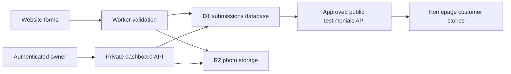

# Owner Dashboard

The owner dashboard is a private website view for reviewing and permanently
deleting Builds, Rentals, Testimonials, and future registered form types. It
also owns the testimonial approval workflow. The
website owns its submission data; Google Forms, Google Sheets, service accounts,
and Apps Script are not part of the backend.

## Data flow

D1 is the system of record. It stores the submission ID, type, status, time,
common searchable customer fields, a short summary, and the form-specific
answers. Approved testimonials also record the approval time and the
authenticated owner's email. R2 stores photo bytes, while the related D1 rows
store filenames, types, sizes, and R2 keys.

## Protection

`/admin/` and `/api/admin/*` are protected on the server. Sites supplies the
signed-in account email in `oai-authenticated-user-email`; the Worker then
requires that address to appear in `DASHBOARD_ADMIN_EMAILS`. Missing
configuration fails closed.

The browser never receives the D1 binding or unrestricted database access. All
queries use prepared SQL statements inside the Worker. Responses use private,
no-store headers.

## Database setup

The logical database and photo bindings are declared in `.openai/hosting.json`:

- `DB` is the D1 relational database.
- `SUBMISSION_PHOTOS` is the R2 upload bucket.

The schema lives in `db/schema.ts`. Versioned SQL files live in `drizzle/` and
are included with the deployment package. After changing the schema, run
`npm run db:generate`, inspect the generated SQL, and then run `npm test`.

The only dashboard environment value is:

- `DASHBOARD_ADMIN_EMAILS`

No database credentials are placed in `.env`; Sites supplies the DB and R2
bindings at runtime.

## Adding another form

`src/server/forms/registry.js` is the central list of form types. A future form
adds one registry definition and one focused route handler containing its field
validation. The shared repository, dashboard authentication, search,
pagination, row design, details dialog, deletion confirmation, and file storage
remain unchanged.

Common fields such as customer name, email, phone, neighborhood, submission
time, and summary receive normal searchable columns. Unique answers are stored
in the submission's JSON data field, so adding a question normally does not
require a migration.

## Permanent deletion

The owner must confirm deletion in a separate warning dialog. The Worker then:

1. Validates the signed-in owner, form type, and submission ID.
2. Reads only the R2 keys related to that submission.
3. Deletes the D1 submission; its file-metadata rows cascade through the foreign
   key.
4. Deletes the related R2 photo objects.

If photo cleanup fails after the database entry is gone, the dashboard returns
a warning and the server records a bounded error without exposing customer data
or internal configuration.

## Testimonial review

New testimonials start as `Pending review` and are never public automatically.
The owner has two choices:

1. **Approve and publish** changes the status to `Approved` and records the
   signed-in owner and approval time. The homepage public endpoint returns only
   the name, optional organization, and testimonial text.
2. **Disapprove and delete** uses the permanent-deletion confirmation and
   removes the testimonial record. An approved testimonial can also be removed
   later, which removes it from the homepage.

The public endpoint never returns email addresses, phone numbers, verification
contacts, or the full private submission data.

## Local and automated verification

Run `npm test`. The suite rebuilds the static site and Worker, then verifies:

- authentication fails closed;
- mixed form types save to and load from D1;
- search and stable cursor pagination work;
- file metadata is related to the correct submission;
- permanent deletion removes the D1 record and only its related R2 objects;
- testimonial approval is owner-only, requires publication consent, records the
  approved state, and exposes only safe public fields;
- the three existing customer submission routes write to D1;
- invalid form types are rejected before storage is touched;
- the admin page and API remain protected.

For a safe visual preview, open `/admin/?fixture=1` on localhost. Fixture mode
is disabled on non-local hosts, and its Delete action changes fixture data only.
A live end-to-end test should use one clearly labeled test submission.
